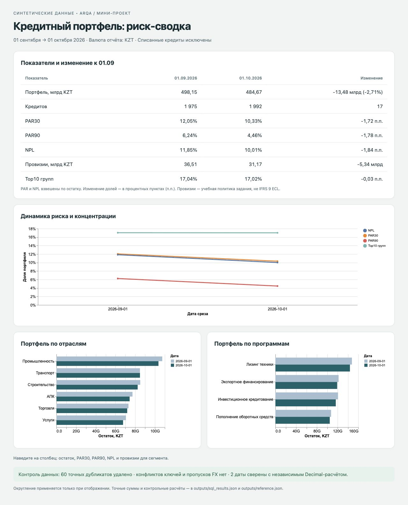
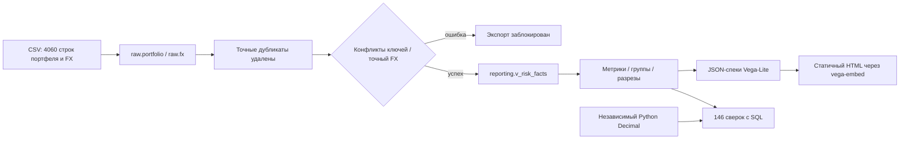

# Риск-сводка кредитного портфеля

Мини-проект для arqa по исходному заданию https://jobs.arqa.cc/bi. Только предоставленные синтетические данные. Исходное задание: https://jobs.arqa.cc/bi; проверка требований — [REQUIREMENTS.md](REQUIREMENTS.md).

## Результат



| Показатель | 01.09.2026 | 01.10.2026 | Изменение к 01.09 |
|---|---:|---:|---:|
| Портфель, KZT | 498 153 228 694,5730 | 484 674 770 832,7580 | −13 478 457 861,8150 (−2,71%) |
| Несписанных кредитов | 1 975 | 1 992 | +17 |
| PAR30 | 12,05% | 10,33% | −1,72 п.п. |
| PAR90 | 6,24% | 4,46% | −1,78 п.п. |
| NPL | 11,85% | 10,01% | −1,84 п.п. |
| Провизии, KZT | 36 512 259 066,298890 | 31 171 241 408,377950 | −5 341 017 657,920940 |
| Top10 групп | 17,04% | 17,02% | −0,03 п.п. |

Проценты округлены только для представления. Точные суммы и доли — в [outputs/sql_results.json](outputs/sql_results.json). Числители и знаменатели включают один и тот же набор несписанных кредитов.

## Три вывода для риск-комитета

1. **Доля проблемных кредитов снизилась, но два среза не доказывают улучшение выдач.** NPL снизился с 11,85% до 10,01%, PAR90 — с 6,24% до 4,46%, портфель сократился на 2,71%. Перед изменением лимитов нужно разделить погашения, выдачи, списания и миграции DPD на уровне loan_id; уменьшение доли само по себе не доказывает положительный эффект модели.
2. **Промышленность требует отдельного разбора ранней просрочки.** В этом секторе PAR30 вырос с 8,47% до 16,45% при снижении остатка с 107,41 до 103,59 млрд KZT. NPL 13,53% выше совокупных 10,01%, а провизии выросли с 8,79 до 8,88 млрд KZT. Следующее действие — изучить крупнейшие группы и миграции 31–90 дней, не приписывая рост конкретной причине без детализации.
3. **Концентрация почти не изменилась.** На десять крупнейших связанных групп приходится 17,04% → 17,02% портфеля. Снижение NPL не устраняет концентрационный риск. Контроль лимитов следует вести по group_id, агрегируя все кредиты группы до ранжирования; десять крупнейших кредитов дают другой показатель.

## Запуск

Требуются Node.js18+ и Python3.9+; все Python-скрипты используют стандартную библиотеку.

```sh
npm ci --ignore-scripts --no-audit --no-fund
npm run build
python3 -m http.server 8080 --bind 127.0.0.1 --directory dashboard
```

Откройте http://127.0.0.1:8080. HTML загружает JSON через HTTP; запуск через file:// не предусмотрен. Vega, Vega-Lite и vega-embed копируются из закреплённых package-lock.json зависимостей в dashboard/vendor; после сборки внешние CDN не нужны. Лицензии библиотек сохранены рядом.

`npm run build`:
1. Вычисляет независимый эталон Python Decimal из CSV.
2. Загружает те же CSV в PostgreSQL17.5 через PGlite, выполняет исходные SQL-вьюхи и проверки.
3. Экспортирует метрики, JSON-спеки Vega-Lite и данные HTML.
4. Сопоставляет SQL с эталоном: 146 числовых сверок, включая оба разреза и их суммы.

Для обычного PostgreSQL16 предоставлен дополнительный запуск:
```sh
bash scripts/run_postgres.sh
```
Он создаёт отдельный временный контейнер, не публикует порт БД, загружает CSV через COPY, проверяет качество и выводит метрики. После завершения контейнер останавливается. **Этот Docker-путь локально не выполнен:** сокеты Docker CLI недоступны. Фактически выполнены все SQL-вьюхи и тесты в настоящем PostgreSQL17.5/PGlite; это не SQLite и не эмуляция формул на Python. Вывод версии и результаты — [outputs/verification.json](outputs/verification.json).

## Поток данных и принятые решения



- **Точный дубликат** определяется по всем полям. Обнаружено60: по30 на дату. После удаления4000 строк, по2000 на дату. Конфликтующие значения для одного (report_date, loan_id) не выбираются произвольно: такой конфликт блокирует экспорт.
- **Валютная переоценка:** остаток в валюте кредита × курс на точную дату среза; KZT=1. Курс USD:478,35 и482,10. При отсутствии курса нет незаметного перехода на вчерашний, NULL-суммы или пропуска кредита: качество блокирует экспорт.
- **Списанные** исключены:25 строк на01.09 и8 на01.10 после дедупликации. Это число записей в срезах, а не число списаний за месяц.
- **Пороговые значения:** PAR30 строго >30, PAR90 строго >90; NPL — >90 или restructured=1.
- **Провизии:** NPL имеет приоритет —50%; иначе31–90 дней —10%, до30 включительно —1%. Это упрощённая политика задания, не полноценная IFRS9 ECL и не регуляторная рекомендация.
- **Концентрация:** сумма остатков по связанным группам, ранжирование внутри даты, первые10 / общий портфель. При равных остатках порядок стабилен по group_id.
- **Деньги:** PostgreSQL numeric и Python Decimal. В JavaScript Number переводится только отображение; исходные экспорты сохраняют точные десятичные строки.
- **Идемпотентность:** CREATE IF NOT EXISTS для raw, CREATE OR REPLACE VIEW для reporting. Перезагрузка CSV целиком выполняется в транзакции; повтор не удваивает строки.
- **YAML-контракт:** [model/portfolio.yaml](model/portfolio.yaml) содержит ровно запрошенные поля измерений и sum/avg/count-меры. PAR/NPL считаются как отношение сумм, не как среднее процентов. Top10 также неаддитивен. Эти вычисления явно заданы в SQL, поскольку простой контракт задания не имеет типа ratio/top-N.

## Проверки и ограничения

В PostgreSQL выполнено10 сценариев: повторная загрузка, повторное создание вьюх, чистота источника, границы30/31/90/91, реструктуризация с нулевой просрочкой и ставкой50%, исключение списаний, группы вместо отдельных кредитов, блокировка при отсутствии FX, конфликте кредита или FX. Все тестовые записи изолированы транзакциями с ROLLBACK; затем исходные итоги повторно проверены.

Независимые146 Decimal-сверок покрывают все показатели и изменения обеих дат,20 сегментных строк и сверку сумм сегментов с общим портфелем. Допуск для долей —1e-15; денежные суммы сверяются без округления. Дашборд проверен в браузере:3 SVG-графика, таблица обеих дат и изменений, отсутствие горизонтального переполнения на контрольном экране. Скриншот выше получен с реально построенной страницы.

Производственные ограничения: здесь два синтетических среза и нет бухгалтерского эталона, истории платежей, выдач, списаний или изменений связанности. Поэтому нет утверждения о сверке с реальным балансом, причинном эффекте модели, соблюдении IFRS9 или готовой промышленной платформе. Для промышленного потока нужны управляемый источник FX, версионирование определений, журнал сверок, ограничения доступа и согласованный процесс исправления исторических отчётов.

## Использование AI-агента

Задание выполнено с Codex; работа с Claude Code не заявляется. Инструкции, реально использованные для решения, — [AGENTS.md](AGENTS.md).

Конкретная ошибка агента: первая версия независимого проверяющего скрипта использовала `zip(..., strict=True)`, которого нет в локальном Python3.9. Ошибка обнаружена при исполнении, заменена явной проверкой равенства длин и обычным zip. После исправления независимая сверка прошла. Также после недоступности Docker не стали выдавать Python-расчёт за PostgreSQL: те же SQL-файлы проверены в PostgreSQL/PGlite, а неисполненный Docker16-путь обозначен отдельно.

## Состав репозитория

- sql/ — типизированный raw-слой, витрины, метрики и проверки.
- model/ — семантическая YAML-модель.
- scripts/ — независимый расчёт, PostgreSQL-прогон, сверка и дополнительный Docker-путь.
- dashboard/ — HTML, JSON-спеки, данные, локальные библиотеки и фактический скриншот.
- outputs/ — точные результаты, контрольные числа, версия PostgreSQL и проверочные отчёты.
- data/ — исходные синтетические CSV без изменений.

Личные контакты и резюме в этот проект не включены.

